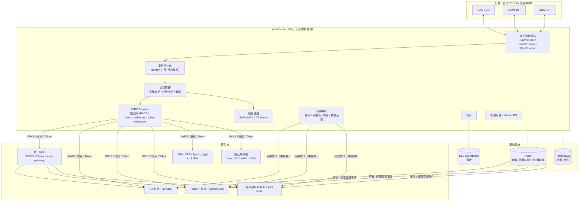
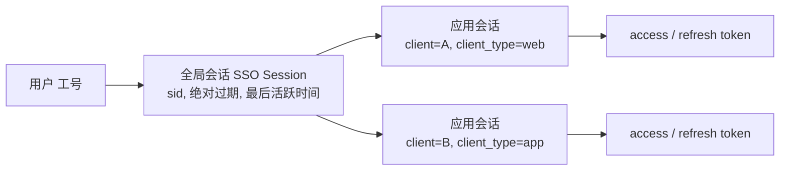
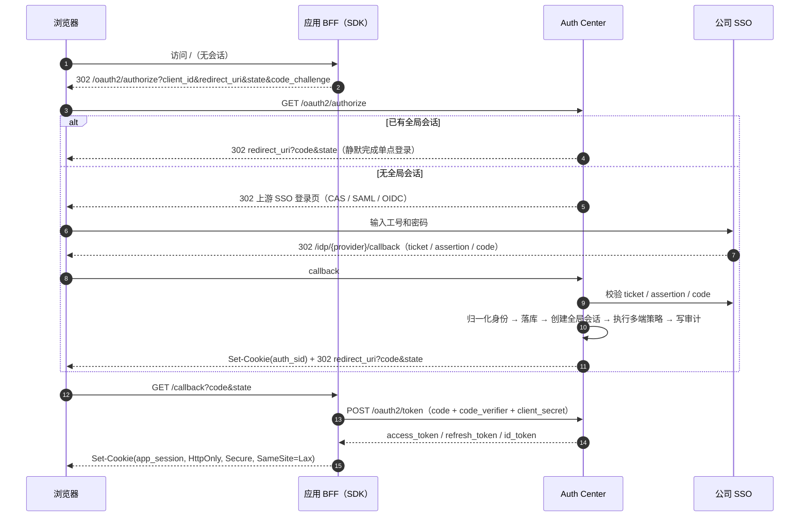
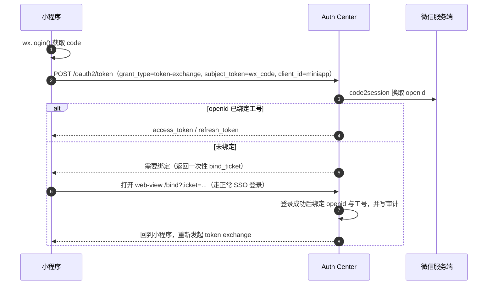
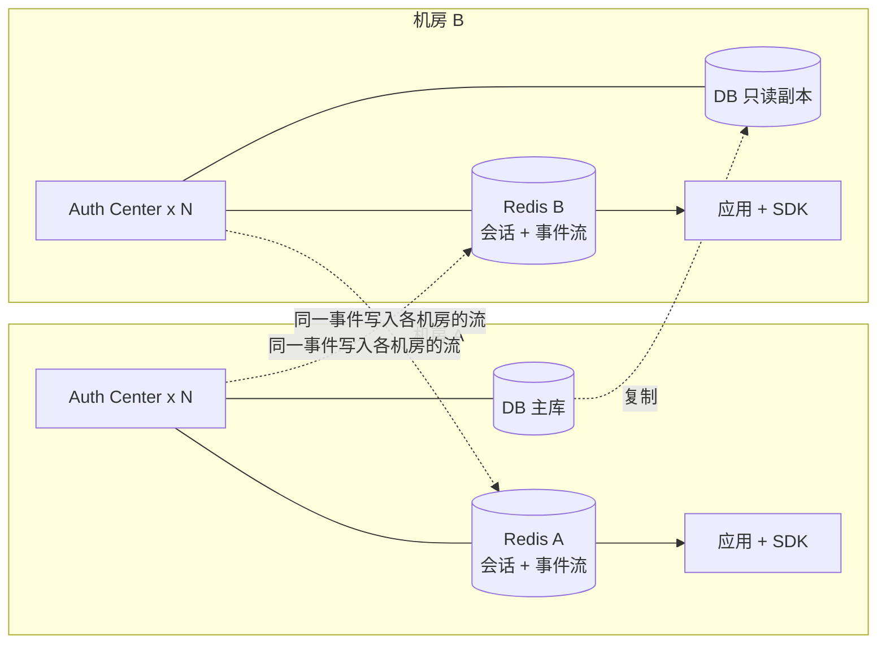
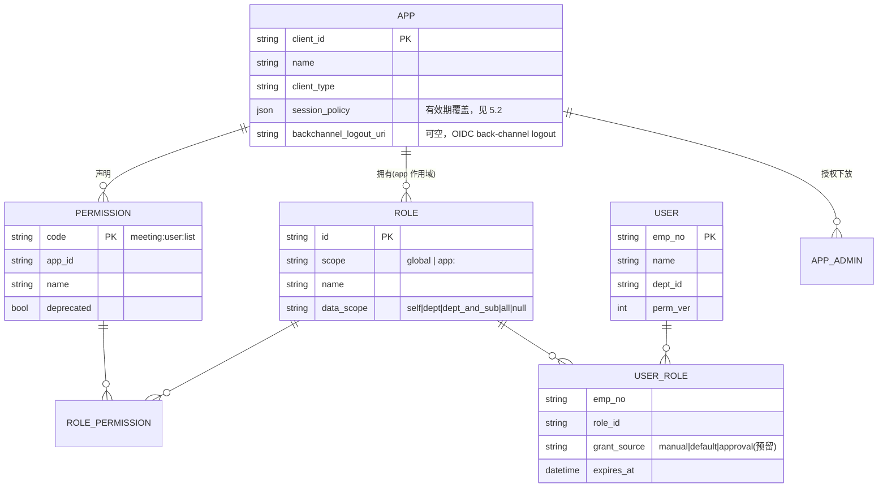

# 统一登录鉴权平台设计文档（Unified Auth）

| 项 | 内容 |
|---|---|
| 状态 | 草案 v0.1（待评审） |
| 日期 | 2026-10-19 |
| 修订 | 2026-10-20：与 spec 对齐；上游三种协议均为必做；token 有效期按客户端配置；事件通道首期用 Redis Streams |
| 适用范围 | 公司内 Go / FastAPI / SpringBoot 项目，以及 Web、移动 App、小程序、第三方 Open API |

---

## 1. 背景与目标

公司内有多个开发团队、多个项目，每个项目都需要同一套登录鉴权能力：**使用公司 SSO，以工号和密码登录**。项目技术栈包括 Go、FastAPI 和 SpringBoot。目前各项目各自对接、各自实现，存在以下问题：重复开发、行为不一致、安全基线参差不齐、合规审计无法统一。

### 1.1 目标

1. **统一认证**：所有项目通过统一认证中心（Auth Center）接入公司 SSO，项目本身不再直接对接 SSO 协议。
2. **多协议兼容**：上游兼容公司 SSO 的 CAS、SAML 2.0、OIDC 三种协议；下游以 OIDC 为主，并提供 SAML、CAS 兼容通道。
3. **多技术栈低成本接入**：Go、Python、Java 三端各提供一个薄 SDK，再加一个前端 JS SDK，几行配置即可接入。
4. **多种部署形态**：既支持 K8s 统一网关模式，也支持项目独立部署接入；同时覆盖内网、公网和多机房。
5. **完整的会话治理**：会话有效期、空闲超时、多端登录策略、强制下线。
6. **集中权限管理**：权限集中定义、分布执行，支持跨应用的通用角色。
7. **合规**：满足等保要求的审计日志及其保存期限。

### 1.2 非目标（本期不做）

- 多租户。
- 组织架构、人员数据同步：只使用 SSO 返回的属性，有就用，没有就当不存在。
- 权限申请审批流：只预留数据模型，不实现流程。
- 替代公司 SSO 本身：认证中心不存储密码，也不负责密码校验。

---

## 2. 需求约束汇总

| 维度 | 约束 |
|---|---|
| 上游 SSO | 必须实现 CAS、SAML 2.0、OIDC 三种上游适配，作为可插拔兼容层，可多套并存。各环境配置身份源地址和属性映射 |
| 用户属性 | 工号必有，其余属性视 SSO 返回情况而定；**属性缺失不能阻塞任何流程** |
| 用户准入 | 所有能通过 SSO 认证的用户都可以登录，具体能做什么由角色决定 |
| SSO 单点登出 / MFA | 待确认，不阻塞整体流程 |
| 维护方 | 开发团队；技术栈以"多语言项目易维护、易嵌入"为原则，不偏向 Java |
| 客户端形态 | SPA、服务端渲染、移动 App、小程序、第三方 Open API |
| 域名 | 以同父域名为主，同时支持跨域名接入 |
| 部署 | K8s + 统一网关为主，同时支持独立接入；内网和公网并存；多机房 |
| 规模 | 项目数、用户量、并发均不设上限，按水平扩展设计 |
| 存量迁移 | 逐步迁移，迁移时可以接受用户重新登录 |
| 会话 | 有效期、空闲超时、多端策略、强制下线均需支持 |
| 合规 | 等保、审计日志、保存年限 |
| 权限 | 集中管理，存在跨应用通用角色，暂不做审批流 |

---

## 3. 总体架构



### 3.1 设计原则

1. **协议在中心收敛**：三种上游协议的复杂度只存在于认证中心，下游项目只需要理解 OIDC 和 JWT。
2. **本地验签，不依赖中心**：业务请求不需要实时调用认证中心。认证中心不可用时，只影响新的登录，不影响已登录用户。
3. **契约优先于代码**：先定义 claims、错误码、事件格式等契约，三端 SDK 按契约实现，并用一致性测试保证行为一致。
4. **可选字段宽容**：除工号外，所有用户属性都是可选的；SDK 和业务代码遇到字段缺失时降级处理，不报错。
5. **网关是增强，SDK 是底线**：网关模式和独立模式使用同一套 SDK，只是配置不同。

---

## 4. 技术选型

### 4.1 结论：用 Go 自研认证中心，协议层使用成熟库

| 方案 | 结论 | 理由 |
|---|---|---|
| Keycloak | 不采用 | Java 技术栈，较重；会话策略、跨机房吊销等定制需要编写 SPI，团队维护成本高 |
| Apereo CAS Server | 不采用 | 上下游三种协议都支持，但配置复杂、技术栈重 |
| Casdoor | **备选** | Go 实现，功能全，适合快速起步；但细粒度会话策略、跨机房吊销需要深度改造 |
| **Go 自研 + 成熟协议库** | **采用** | 与 Go 项目同栈；会话、吊销、审计完全可控；协议细节交给经过验证的库 |

### 4.2 组件清单

| 组件 | 选型 |
|---|---|
| 语言 / 框架 | Go 1.23+，HTTP 框架用 Chi（兼容 net/http） |
| OIDC Provider | `github.com/zitadel/oidc/v3`（OpenID 认证实现）；备选 `ory/fosite` |
| 上游 OIDC | `github.com/coreos/go-oidc/v3` |
| SAML（上游 SP / 下游 IdP） | `github.com/crewjam/saml` |
| CAS（上游客户端 / 下游 Server） | 自研。协议面很小：`/login`、`/serviceValidate`、`/p3/serviceValidate`、`/logout` |
| JWT / JWK | `github.com/go-jose/go-jose/v4` |
| 存储 | PostgreSQL（配置、权限）；Redis（会话、吊销集合、事件流） |
| 事件 | 可插拔事件通道。首期用 Redis Streams；预定替代是 Kafka |
| 审计 | 异步写入 ES 或 ClickHouse |
| 管理后台前端 | React（TypeScript + Vite），组件库 Ant Design。页面在 `admin-ui/`。P1 用引导令牌调用 Admin API |

---

## 5. 核心模块设计

### 5.1 上游身份源适配层

```go
// IdentityProvider 抽象上游 SSO。CAS、SAML、OIDC 三种都必须有实现；以后增加协议时再新增实现
type IdentityProvider interface {
    ID() string                                   // 例如 "corp-cas"、"corp-saml"
    Protocol() Protocol                           // CAS | SAML | OIDC | CUSTOM
    BuildLoginRedirect(ctx context.Context, state string) (url string, err error)
    HandleCallback(ctx context.Context, r *http.Request) (*Identity, error)
    BuildLogoutRedirect(ctx context.Context, hint LogoutHint) (url string, ok bool) // 上游不支持登出时 ok=false
}

// Identity 归一化后的身份，只有 EmpNo 必填
type Identity struct {
    EmpNo    string            // 工号，全局唯一主键
    Name     *string
    Email    *string
    Mobile   *string
    DeptID   *string
    DeptName *string
    Raw      map[string]any    // 上游原始属性，仅用于审计和排障，不下发给应用
    Provider string
    AuthTime time.Time
    AMR      []string          // 认证方式，例如 ["pwd"] 或 ["pwd","otp"]
}
```

- **三种上游都要做**：CAS、SAML 2.0、OIDC 都是必交付的适配器，挂在上面的接口上。P1 先实现 OIDC 上游适配，CAS 和 SAML 2.0 在 P6 补齐。以后可以再加其他协议，但不能因此少做这三种。
- **属性映射可配置**：每个身份源配置一份 `attribute_mapping`，例如 CAS 返回的 `employeeNumber` 映射到 `EmpNo`，SAML 的 `urn:oid:...` 映射到 `Email`。
- **多身份源并存**：只配置了一个身份源时直接跳转；没有配置身份源时授权端点返回 `temporarily_unavailable`。配置了多个时，在认证中心的登录页提供选择，或者由客户端通过 `idp_hint` 参数指定。选择页由授权端点服务端渲染（中文与英文），不在管理后台里。语言先看 `ui_locales` 里第一个支持的标签（只认 `zh` 与 `en`），再看 `Accept-Language`，都没有则用中文。用户看到页面前，授权请求（`client_id`、`redirect_uri`、`state`、`nonce`、PKCE、`scope`）已经写入授权事务；选定身份源后绑定同一事务并跳转上游，客户端不必重新发起授权。`idp_hint` 命中时跳过选择页。未知的 `idp_hint` 重定向到 `redirect_uri`，`error=invalid_request`。`prompt=none` 且没有会话时仍返回 `login_required`，不展示选择页。刷新选择页会重新进入授权端点并生成新事务，旧事务到期失效。身份源没配 `display_name` 时，选择页用它的 id。
- **用户落库**：首次登录时以工号为键自动创建用户，并授予只读基础角色 `default:viewer`（全局角色，`data_scope` 为 `self`）。只在真正插入新用户时授予，之后的登录不补授。之后每次登录刷新可选属性。属性为空时不覆盖已有值。

### 5.2 Token 设计

**Access Token（JWT）**

JOSE 头 `typ` 必须是 `at+jwt`（也接受 `application/at+jwt`，不区分大小写），用来防止 ID Token 被当成 Access Token 使用。签名算法只允许 `RS256` 和 `ES256`。SDK 按白名单校验，不得根据头部声明的 `alg` 动态选择验证方式。

| claim | 必填 | 说明 |
|---|---|---|
| `iss` | 是 | 统一的 issuer，例如 `https://auth.corp.com`；内外网使用同一个值。校验时必须与配置完全相等 |
| `sub` | 是 | 用户 token 为工号；m2m token 为 `client:<client_id>` |
| `aud` | 是 | 受众的 `client_id`，可以是字符串或字符串数组（token exchange 时可能有多个受众）。SDK 只要求本应用的 `client_id` 在其中 |
| `exp` / `iat` | 是 | 过期时间与签发时间。有效时长取该客户端的 `access_token_ttl`，未配置时用下面的全局默认 |
| `nbf` | 否 | 生效时间。不出现表示立即生效 |
| `jti` | 是 | Token 唯一 ID |
| `sid` | 非 m2m 必填 | 全局会话 ID，前缀带机房标识，例如 `bj1.xxxx`。m2m 没有会话，不带此字段 |
| `asid` | 非 m2m 必填 | 应用会话 ID。SDK 用它匹配只踢掉某一个应用会话的吊销事件 |
| `azp` | 是 | 实际发起请求的客户端。token exchange 场景下可能与 `aud` 不同；SDK 输出的 `User.client_id` 取这个值 |
| `amr` / `auth_time` | 否 | 认证方式和认证时间，有值才出现 |
| `name` / `email` / `dept_id` / `dept_name` | 否 | **有值才出现**；空字符串视同不存在 |
| `perm_ver` | 是 | 用户权限版本号，整数且 ≥ 0，用于判断权限缓存是否失效 |
| `scope` | 否 | Open API 场景使用，空格分隔 |
| `client_type` | 是 | 客户端类型：`web` / `ssr` / `app` / `miniapp` / `m2m` |

不认识的 claim 一律忽略。JWT 里不放权限点。出现了的可选字段必须是正确的类型，否则视为 token 无效。

**Refresh Token**：使用不透明随机串，存储在 Redis 中；每次使用后轮换，检测到旧 token 被重复使用时，吊销整个会话链。m2m 不签发 refresh token。轮换发出的新 refresh token 从轮换当时起重新计算 `refresh_token_ttl`（滑动刷新）。全局默认 600 秒（10 分钟），与会话绝对时长无关；客户端可以单独覆盖。会话仍受空闲超时和会话绝对时长约束，刷新时这三项先到期的那个生效。超过 `refresh_token_ttl` 没有成功轮换就必须重新登录；在到期前持续轮换，会话可以延续到空闲超时或绝对时长。

**ID Token**：按 OIDC 标准签发，只给前端或客户端用来展示用户信息，**不能**拿来访问 API。

**有效期**：每个注册客户端可以覆盖下面几项，写在该客户端的 `session_policy` 里。某一项没填时，用该 `client_type` 的全局默认。下表的数字就是全局默认。

| 客户端类型 | `access_token_ttl` | `refresh_token_ttl` | `idle_timeout` | `absolute_session_ttl` |
|---|---|---|---|---|
| web / ssr | 10 分钟（600 秒） | 10 分钟（600 秒） | 2 小时（7200 秒） | 12 小时（43200 秒） |
| app | 10 分钟（600 秒） | 10 分钟（600 秒） | 7 天（604800 秒） | 30 天（2592000 秒） |
| miniapp | 10 分钟（600 秒） | 10 分钟（600 秒） | 7 天（604800 秒） | 30 天（2592000 秒） |
| m2m（机器对机器） | 30 分钟（1800 秒） | 不签发 | — | — |

字段都是整数秒。`access_token_ttl` 还要受全局上限 `access_token_ttl_cap` 约束，该项是认证中心配置，默认 1800 秒（与 m2m 的全局默认相同）。客户端填的值或全局默认若超过上限，按上限截断。因此任何 access token 的有效期都不会超过 `access_token_ttl_cap`。要签发更长的 access token，先调高这个上限；吊销保留时间和 JWKS 旧密钥窗口会跟着变长。`refresh_token_ttl` 不受这个上限约束。

空闲超时和会话绝对时长沿用上表，同样可以按客户端覆盖。m2m 没有会话，这两项和 refresh token 都不适用。

全局默认下，单次 refresh token 与用户 access token 同为 600 秒，短于 `idle_timeout` 和 `absolute_session_ttl`。因为是滑动刷新，客户端在 600 秒内成功轮换就能继续，直到空闲超时或绝对时长。Redis 中 `auth:rt:{refresh_hash}` 的 TTL 取该客户端的 `refresh_token_ttl`，从该 token 签发或轮换时起算。

**授权码与授权事务**不在客户端 `session_policy` 里，是认证中心进程配置。`auth_code_ttl` 默认 60 秒，授权码写入 Redis 后到期失效。`authorize_txn_ttl` 默认 600 秒，从保存授权事务起计算；选择页绑定身份源时按当时重新计算。YAML 键是 `auth_code_ttl`、`authorize_txn_ttl`，环境变量是 `AUTH_CENTER_AUTH_CODE_TTL`、`AUTH_CENTER_AUTHORIZE_TXN_TTL`。都是整数秒，至少 1。不能按客户端覆盖。

**密钥管理**：
- P1 从 PEM 文件加载签名私钥，各机房挂同一套内容。配置写在 `keys[].pem_file`，或环境变量 `AUTH_CENTER_KEY_ACTIVE_PEM_FILE`（可选 `AUTH_CENTER_KEY_ACTIVE_KID`、`AUTH_CENTER_KEY_ACTIVE_ALG`）。下一把密钥用 `AUTH_CENTER_KEY_NEXT_PEM_FILE`、`AUTH_CENTER_KEY_NEXT_KID`、`AUTH_CENTER_KEY_NEXT_ALG`。设置了 active PEM 环境变量时，不再使用文件里的 `keys`。Kubernetes 上把 Secret 挂到这些路径。KMS 不在 P1，延后到 P7。
- JWKS 在轮换前同时发布当前密钥和下一把密钥。轮换完成后，上一把密钥继续发布 `access_token_ttl_cap + previous_key_buffer` 秒。`previous_key_buffer` 是认证中心配置，整数秒，默认 60（1 分钟）。默认一共 1860 秒（1800 + 60）。不按某个客户端的较短有效期缩短这段时间：客户端可以把 access token 调到上限，窗口必须盖住这个上限。每 90 天轮换一次。
- 认证中心启动时如果发现签名密钥与 `conformance/keys/` 中的测试密钥相同，必须拒绝启动。

### 5.3 会话管理

#### 5.3.1 三层会话模型



Redis 数据结构（按机房存储）：

```
auth:gs:{sid}                    HASH  sub, idp, created_at, last_active, abs_exp, ip, ua
auth:gs:{sid}:apps               SET   app_session_id...
auth:as:{asid}                   HASH  sid, client_id, client_type, created_at, last_active
auth:user:{sub}:sessions         ZSET  asid -> created_at（按客户端类型分 key，用于多端计数）
auth:rt:{refresh_hash}           HASH  asid, family_id, used   TTL = 该客户端 refresh_token_ttl
auth:revoked:sid                 SET   最近被吊销的 sid（TTL >= access_token_ttl_cap + clock_skew，默认 1860 秒）
```

#### 5.3.2 策略

| 策略 | 实现方式 |
|---|---|
| 会话绝对有效期 | 全局会话设置 `abs_exp`，到期后拒绝刷新，需要重新登录 |
| 空闲超时 | 刷新 token 或访问认证中心时更新 `last_active`；当前时间减去 `last_active` 超过空闲时长时，拒绝刷新 |
| 多端登录 | 按"用户 + 客户端类型"（可选再加 client）计数。策略可选：`allow`（不限制）/ `limit:N`（拒绝新登录）/ `kick_oldest`（踢掉最早的会话） |
| 强制下线 | 管理员、用户本人或风控规则触发吊销后，发布吊销事件；SDK 实时同步，秒级生效 |
| 单点登出 | 用户主动登出时，按全局会话找到所有应用会话，逐个发送 OIDC back-channel logout 通知；SAML 和 CAS 应用分别走各自协议的登出流程；如果上游 SSO 支持登出，再跳转到上游登出 |

#### 5.3.3 吊销事件与 SDK 同步

```json
{
  "id": "rv_01JAXA0",
  "event": "auth.revoked",
  "type": "session",
  "sid": "bj1.8f2c4a9e",
  "sub": "E10023",
  "ts": 1792374900,
  "dc": "bj1",
  "reason": "admin_kick"
}
```

`id` 必填，消费方按 `id` 幂等去重。`type` 取 `session`、`app_session`、`user`、`client`：`session` 必须带 `sid`，`app_session` 必须带 `asid`，`user` 必须带 `sub` 和 `not_before`，`client` 必须带 `client_id` 和 `not_before`。`dc` 是触发吊销的机房。

`reason` 共 9 种，管理端强制下线接口与吊销事件使用同一份枚举：`logout`、`admin_kick`、`policy_kick_oldest`、`idle_timeout`、`absolute_timeout`、`refresh_reused`、`risk`、`client_disabled`、`user_disabled`。请求未带 `reason` 时默认为 `admin_kick`。事件的 `type` 由调用的接口决定，与 `reason` 无关。

命中任意一条即视为已吊销：

| 事件 `type` | 命中条件 |
|---|---|
| `session` | `event.sid` 等于 `token.sid` |
| `app_session` | `event.asid` 等于 `token.asid` |
| `user` | `event.sub` 等于 `token.sub`，且 `token.iat` < `event.not_before` |
| `client` | `event.client_id` 等于 `token.azp`，或出现在 `token.aud` 中；并且 `token.iat` < `event.not_before` |

`user` 和 `client` 用 `not_before` 比较，因此吊销之后重新签发的 token 不受影响。例如用户被强制下线后重新登录，新 token 可以正常使用。

SDK 获取吊销事件有两种渠道。配置项 `revocation.channel` 默认 `auto`，由 SDK 按网络环境选择：

1. **内网**：走可插拔的事件通道，首期实现是本机房的 Redis Streams。认证中心和 SDK 只依赖 `EventBus` 这一层，以后换成 Kafka 时事件格式不变。每个机房一条流 `auth:events`，里面有 `auth.revoked` 和 `authz.changed`。每个 SDK 实例记住自己的游标，用 `XREAD` 接着读，不和别的实例共用一个 consumer group，因此每个实例都能收到全部事件。断线后从上次游标继续；游标已经被裁掉时，改调 `GET /api/v1/revocations?since=<ts>` 补拉。流的保留时间和吊销记录一样，是 `access_token_ttl_cap + clock_skew`。选用 Streams 是因为流会留下历史，断线后可以按游标补拉。
2. **公网 / 独立部署**：订阅认证中心提供的 `GET /api/v1/revocations/stream`（SSE），连接断开后用 `Last-Event-ID` 重连；超过保留期再用 `GET /api/v1/revocations?since=<ts>` 补拉。

Kafka 是预定替代，不是当前实现。换上之后，主题用 MirrorMaker 2 做跨机房复制；每个 SDK 实例使用自己的 consumer group，这样仍然是广播，而不是在实例之间分摊。

SDK 在本地维护一个吊销集合。每条记录保留到 `event.ts + access_token_ttl_cap + clock_skew`。`access_token_ttl_cap` 是全体客户端 access token 有效期的上限，默认 1800 秒；任何客户端的有效 `access_token_ttl` 都不会超过它，所以吊销保留时间可以只由这项全局配置算出来，不必扫描全部客户端。`clock_skew` 默认 60 秒，因此默认保留 1860 秒。SDK 的 `revocation.retention` 不得小于这个值。调高 `access_token_ttl_cap` 或 `clock_skew` 时，必须同时调高 retention。到点之后受影响的 token 都已自然过期，记录可以清理。

**兜底**：即使事件丢失，access token 也会在自己的有效期之后过期，最长不超过 `access_token_ttl_cap`（默认 30 分钟），过期后刷新会失败。

### 5.4 下游协议

| 协议 | 定位 | 端点 |
|---|---|---|
| OIDC / OAuth2 | **主推**，所有自研项目必须使用 | `/.well-known/openid-configuration`、`/oauth2/authorize`、`/oauth2/token`、`/oauth2/revoke`、`/oauth2/introspect`、`/oauth2/userinfo`、`/oauth2/jwks`、`/oauth2/logout` |
| SAML 2.0 IdP | 兼容通道，供第三方商业软件使用 | `/saml/metadata`、`/saml/sso`、`/saml/slo` |
| CAS Server | 兼容通道，供老系统使用 | `/cas/login`、`/cas/serviceValidate`、`/cas/p3/serviceValidate`、`/cas/logout` |

支持的授权类型：
- `authorization_code`（要求带 PKCE）
- `refresh_token`
- `client_credentials`
- `urn:ietf:params:oauth:grant-type:token-exchange`（用于小程序和服务间的身份传递）

公开客户端是没有 `client_secret` 的 `web`、`app`、`miniapp`（SPA、App、小程序）。授权码已经使用 PKCE S256 时，它们调用 `/oauth2/token` 的 `authorization_code` 和 `refresh_token` 可以不带客户端认证，但必须带 `client_id`。`ssr`、`m2m`，以及任何配置了密钥的客户端，都是机密客户端，换票和刷新都必须认证。公开客户端的 refresh token 仍然每次轮换，重放旧 token 仍然吊销整条会话链。带了密钥就必须和登记的哈希一致，公开客户端也不例外。

`GET /oauth2/logout` 按 RP-Initiated Logout 结束全局会话。会话取验过签的 `id_token_hint`（允许过期）里的 `sid`，没有 hint 时用 `auth_sid` cookie。结束前向每个登记了 `backchannel_logout_uri` 的应用 POST `logout_token`（`typ=logout+jwt`，带 `sid`）。没登记就跳过这次 HTTP，会话和事件照常处理。`backchannel_logout_uri` 是客户端上的可空列，写在 §8.2 的 APP 上。然后发布 `auth.revoked`，`type=session`，`reason=logout`。`post_logout_redirect_uri` 必须与该客户端 `redirect_uris` 里的某一项精确匹配，设计里没有单独的登出回调列表。上游登出只在适配器声明支持时跳转，优先于 `post_logout_redirect_uri`；当前 OIDC 适配器仍返回不支持（R1）。没有可跳转地址时返回 204。

`GET /oauth2/userinfo` 要求 Bearer `at+jwt`。`sub` 必填；`name`、`email`、`dept_id`、`dept_name` 有值才返回。

`POST /oauth2/revoke` 按 RFC 7009。未知 token 也返回 200。它结束对应的应用会话（包括这张会话上的 refresh token），不结束整个全局会话。机密客户端必须认证。公开客户端带 `client_id`，只能吊销发给自己的 token。成功结束应用会话时发布 `auth.revoked`，`type=app_session`，`reason=logout`。

`POST /oauth2/introspect` 按 RFC 7662，只接受机密客户端认证。`active=true` 时附带 access token 的 claims；调用方只能看到 `aud` 或 `azp` 属于自己的 token，否则 `active=false`。设计里的「仅内网」不在进程内做网络限制。

refresh token 被重放时，整条会话链吊销之后再发布 `auth.revoked`，`type=session`，`reason=refresh_reused`。

---

## 6. 客户端接入方案

### 6.1 方式总览

| 形态 | 方式 | Token 存放位置 |
|---|---|---|
| SPA（同父域名） | BFF 模式 + HttpOnly Cookie | 服务端；浏览器只持有会话 Cookie |
| SPA（跨域名） | 优先使用 BFF；纯前端时用授权码 + PKCE | BFF 存服务端；纯前端存内存，刷新借助 iframe 或 refresh token 轮换 |
| 服务端渲染 | 机密客户端 + 授权码模式 | 服务端会话 |
| 移动 App | 授权码 + PKCE，使用系统浏览器（AppAuth） | Keychain / Keystore |
| 小程序 | 首次登录通过 web-view 走 SSO 并绑定 openid；之后用 `wx.login` 静默换取 token | 小程序本地存储（只存 refresh token，加密后存放） |
| 第三方 Open API | 机器调用用 `client_credentials` + scope；代表用户调用用授权码模式 + 用户授权页 | 由第三方保管 |

纯前端 SPA、App、小程序按上表走授权码 + PKCE，不配置 `client_secret`。BFF 与 SSR 配置密钥，换票时必须认证。

### 6.2 Web BFF 登录时序



上面是 BFF，属于机密客户端，换票带 `client_secret`。纯前端 SPA、App、小程序不带密钥，只带 `client_id` 和 PKCE。

### 6.3 小程序登录时序



### 6.4 第三方 Open API

- 第三方应用在管理后台注册，审核通过后获得 `client_id` 和 `client_secret`（或者私钥 JWT 认证），并分配可用的 scope。
- 网关按 `client_id` 限流，并记录调用审计。
- 只有带用户身份的 token 才能访问用户数据；纯 `client_credentials` token 只能访问显式开放给机器调用的接口。

---

## 7. 部署架构

### 7.1 多机房



- **会话就近存储**：`sid` 的前缀带机房标识。刷新请求如果落到了其他机房，由该机房的认证中心把请求转发到会话所在机房（或者通过 GSLB 让同一用户固定访问同一机房）。机房整体故障时，该机房的会话失效，用户需要重新登录，这一点可以接受。
- **配置数据**：写操作只走主库（写入频率很低）；读操作走本机房副本，并加本地缓存。
- **签名密钥**：全局统一，所有机房的 JWKS 内容一致。
- **事件**：吊销和权限变更走 5.3.3 的事件通道。Redis 是每机房一套，Stream 不会复制到其他机房。发布事件的认证中心把同一条事件写入每个机房的 `auth:events`，目标是 5 秒内到达。远程机房写入失败时要重试；在写入成功之前，那个机房的 SDK 看不到这条事件，只能等 access token 过期。换到 Kafka 之后，跨机房改为 MirrorMaker 2 复制主题。

### 7.2 内网与公网

- **统一 issuer 域名**：例如 `auth.corp.com`。内网 DNS 解析到内网入口，公网 DNS 解析到公网入口（WAF → LB → 认证中心）。
- **公网入口**：认证类接口按 IP 和工号限流；`/oauth2/introspect` 和 Admin API 不对公网开放。
- **管理后台**：只允许从内网访问。

### 7.3 网关模式与独立模式

| | 网关模式 | 独立模式 |
|---|---|---|
| 登录跳转 / 回调 | 网关插件或统一 BFF 负责 | SDK 内置的 OIDC 客户端负责 |
| 请求鉴权 | 网关先验签，**转发原始 JWT**；SDK 再验签一次 | SDK 验签 |
| 吊销同步 | 事件通道（Redis Streams） | 事件通道，或 SSE（公网环境） |
| 网络防护 | K8s NetworkPolicy 限制只接受来自网关的流量 | 应用自己负责 |

**明确禁止**：网关只传 `X-User-Id` 等明文 Header、后端无条件信任这些 Header 的做法。

---

## 8. 权限模型

### 8.1 原则

**集中定义，分布执行。**
- 认证中心负责：应用、权限点、角色、用户角色绑定、数据范围的管理，以及相关审计。
- 各项目负责：在本地完成权限校验，并实现具体的数据过滤逻辑。

### 8.2 数据模型



- **权限点命名**：`<app>:<resource>:<action>`，正好 3 段，只允许小写，例如 `meeting:user:list`。通配符 `*` 只能出现在已授予的权限里，并且只匹配一整段，例如 `*:audit:view`。`permissions.yaml` 里声明的权限点不允许写通配符。
- **全局角色**：可以包含任意应用的权限点，用于"平台管理员""审计员"这类跨应用角色。只有平台管理员可以管理全局角色。
- **应用角色**：只能包含本应用的权限点，由该应用的管理员（`APP_ADMIN`）自行管理。
- **数据范围**：作为角色的属性存在，从窄到宽为 `self` < `dept` < `dept_and_sub` < `all`。多个角色取最宽的一个；全部为 `null` 时结果为 `null`，由业务决定如何处理。权限接口返回的是未降级的值；结果是 `dept` 或 `dept_and_sub` 且 token 中 `dept_id` 为空时，由 SDK 降级为 `self`。
- **默认角色**：角色 id 为 `default:viewer`，`scope` 为 `global`，名称 `viewer`，`data_scope` 为 `self`。这是只读基础角色，不带权限点。只在第一次插入用户时授予，`grant_source` 为 `default`。已经存在的用户再次登录不补授。

### 8.3 权限声明与同步

每个应用在代码仓库里维护一份 `permissions.yaml`：

```yaml
app: meeting
permissions:
  - code: meeting:user:list
    name: 查看参会人
  - code: meeting:record:export
    name: 导出会议纪要
```

在 CI 流程中，或者服务启动时，通过 `PUT /api/v1/apps/{app}/permissions` 做幂等同步。代码里已经删除的权限点，在中心标记为 `deprecated`，不做物理删除。清单还可以包含格式版本、分组、敏感标记和角色模板，字段以 `spec/schemas/permissions-manifest.schema.json` 为准；上面只列出最少字段。

### 8.4 下发与缓存

1. JWT 中**不放**权限点，只放 `perm_ver`。
2. SDK 调用 `GET /api/v1/authz/users/{sub}/apps/{app}`，获取"全局角色 + 本应用角色"的并集，结果包括权限点集合和数据范围。
3. 本地缓存的键为 `(sub, app)`，TTL 默认 5 分钟。发生以下任一情况时，主动刷新缓存：
   - 收到 `authz.changed` 事件；
   - 当前 token 中的 `perm_ver` 大于缓存中记录的版本。
4. 权限中心不可用时，继续使用过期的缓存（stale-while-error），并上报告警。

---

## 9. 审计与合规

### 9.1 审计范围

| 类别 | 事件 |
|---|---|
| 认证 | 登录成功和失败、上游回调失败、登出、会话过期 |
| 会话 | 强制下线、多端策略踢出、refresh token 重放检测 |
| Token | 签发、吊销、token exchange |
| 授权 | 角色和权限的增删改、用户授权变更、应用管理员变更 |
| 管理 | 应用注册和密钥变更、身份源配置变更、签名密钥轮换 |
| Open API | 第三方调用（在网关层记录） |

### 9.2 记录格式

```json
{
  "id": "ae_01JAX9Y",
  "ts": "2026-10-19T10:00:00.123+08:00",
  "event": "auth.login.success",
  "actor": {"type": "user", "id": "E10023"},
  "target": {"type": "app", "id": "meeting"},
  "client_id": "meeting",
  "client_type": "web",
  "idp": "corp-cas",
  "sid": "bj1.8f2c4a9e",
  "ip": "10.1.2.3",
  "ua": "...",
  "result": "success",
  "reason": null,
  "trace_id": "4bf92f3577b34da6a3ce929d0e0e4736",
  "dc": "bj1"
}
```

`actor` 是对象。`type` 取 `user` / `client` / `system` / `anonymous`，`id` 必填（工号、`client_id`、系统组件名，或匿名尝试登录时的标识）。事件 `id`、`ts`、`event`、`actor`、`result`、`trace_id`、`dc` 必填。可选字段还有 `asid` 和 `changes`（变更类事件的前后差异，写入前脱敏）。

P1 把通过 schema 检查的事件追加进 PostgreSQL 表 `audit_events`。登录不因为写审计失败而失败。长期保存、查询审计再记一条，以及 ES 或 ClickHouse，仍见 P7-AUD-01，这里不代选。

### 9.3 合规要求

- 审计数据只追加、不可修改；写入时间和服务器时钟同步到统一的 NTP 源。
- **保存期限不少于 6 个月**，按《网络安全法》第二十一条要求；如果等保定级或公司制度有更高要求，按更高的执行。
- 审计日志的查询权限独立授予，由"审计员"这一全局角色持有；所有查询操作本身也要记录审计。
- **管理后台必须做二次认证**：等保三级通常要求管理员使用两种及以上的认证方式。如果上游 SSO 不支持 MFA，认证中心的管理后台需要叠加 TOTP。
- 敏感字段（手机号、邮箱）在日志中做脱敏处理。不得记录 token、密码、ticket、assertion 原文。

---

## 10. 接入规范

### 10.1 请求约定

- 访问 API 时使用 `Authorization: Bearer <access_token>`。
- BFF 模式下由 Cookie 承载会话，BFF 转发到下游服务时换成 Bearer token。
- 链路追踪使用 `traceparent`（W3C 标准），审计记录中的 `trace_id` 与之关联。

### 10.2 统一错误响应

```json
{ "code": "AUTH_TOKEN_EXPIRED", "message": "access token expired", "trace_id": "..." }
```

必填字段是 `code`、`message`、`trace_id`。可选字段：`details`、`bind_ticket`（仅 `AUTH_BINDING_REQUIRED`），以及 OAuth2 端点上额外的 `error` / `error_description`（RFC 6749）。错误码只增不改，完整清单以 `spec/error-codes.yaml` 为准。

| HTTP | code | 含义 | 客户端处理 |
|---|---|---|---|
| 401 | `AUTH_TOKEN_MISSING` | 未携带 token | 跳转登录 |
| 401 | `AUTH_TOKEN_INVALID` | 格式错误、typ/alg 不合规、kid 未知、签名错误、必填 claims 缺失或类型错误、iss 不匹配、nbf/iat 在未来 | 跳转登录 |
| 401 | `AUTH_TOKEN_EXPIRED` | token 已过期（超出 clock_skew） | 用 refresh token 刷新后重试；刷新失败则跳转登录 |
| 401 | `AUTH_AUDIENCE_MISMATCH` | `aud` 不包含本应用 | 跳转登录 |
| 401 | `AUTH_SESSION_REVOKED` | 会话已被吊销（登出、强制下线、多端策略踢出、风控） | 跳转登录，并提示"已在其他位置下线或被管理员下线" |
| 401 | `AUTH_LOGIN_REQUIRED` | 刷新失败（refresh token 无效、会话绝对过期或空闲超时） | 跳转登录 |
| 401 | `AUTH_REFRESH_REUSED` | 已使用过的 refresh token 被重放，整个会话链已吊销 | 跳转登录 |
| 401 | `AUTH_BINDING_REQUIRED` | 小程序 openid 尚未绑定工号，响应附带一次性 `bind_ticket` | 调用方修正请求 |
| 403 | `PERM_DENIED` | 已认证，但没有对应权限 | 提示无权限，不跳转 |
| 403 | `SCOPE_INSUFFICIENT` | Open API 的 scope 不足 | 调用方修正请求 |
| 409 | `AUTH_CONCURRENT_LIMIT` | 多端策略为 `limit:N` 且已达上限，拒绝新登录 | 提示已达上限，不跳转登录 |
| 400 | `INVALID_REQUEST` | 参数缺失或格式错误。授权端点上未知或停用的客户端也用这个码，且不重定向 | 调用方修正请求 |
| 401 | `INVALID_CLIENT` | 客户端认证失败（RFC 6749 `invalid_client`）。令牌、吊销、内省返回 HTTP 401，并带 `WWW-Authenticate`。不是终端用户登录失败 | 调用方修正请求 |
| 404 | `NOT_FOUND` | 资源不存在 | 调用方修正请求 |
| 429 | `RATE_LIMITED` | 触发限流 | 遵循 `Retry-After`，退避后重试 |
| 500 | `INTERNAL_ERROR` | 认证中心内部错误，响应不含内部细节。浏览器授权跳转里的 OAuth `server_error` 仍是 302，不用这个码 | 退避后重试 |
| 502 | `AUTH_UPSTREAM_FAILED` | 上游 SSO 校验失败或不可达 | 退避后重试 |
| 503 | `AUTH_DEPENDENCY_UNAVAILABLE` | SDK 拿不到任何可用 JWKS，或认证中心依赖组件不可用 | 退避后重试 |

### 10.3 应用接入流程

1. 注册应用，获得 `client_id` 和 `client_secret`，并配置回调地址、客户端类型、会话策略。可以调用 `POST /api/v1/apps`，也可以打开 `admin-ui/` 里的 React 页面（见 `docs/pilot-login.md`）。
2. 引入对应语言的 SDK，填写配置。
3. 在仓库中提交 `permissions.yaml`，并接入 CI 同步。
4. 运行 SDK 自带的一致性自检命令，例如 `unified-auth doctor`，检查连通性、JWKS 可用性和时钟偏差。
5. 在测试环境验证通过后，申请生产环境的客户端凭证。

---

## 11. SDK 接口定义

### 11.1 通用配置

```yaml
unified_auth:
  issuer: https://auth.corp.com
  client_id: meeting
  client_secret: ${UA_CLIENT_SECRET}      # 只有 BFF / SSR / 机器调用需要
  mode: gateway | standalone              # standalone 模式下启用登录跳转和回调
  redirect_uri: https://meeting.corp.com/auth/callback
  public_paths: ["/health", "/docs/**"]
  clock_skew: 60                          # 秒，整数；默认 60，最大 300
  revocation:
    channel: auto | mq | sse | none       # 默认 auto：内网走事件通道（mq，当前是 Redis Streams），公网或独立部署走 sse
    retention: 1860                       # 秒；必须 >= access_token_ttl_cap + clock_skew，默认 1800 + 60
  authz:
    enabled: true
    cache_ttl: 300                        # 秒，默认 300（5 分钟）
```

### 11.2 能力矩阵（三端必须一致）

| 能力 | Go | Python (FastAPI) | Java (SpringBoot) |
|---|---|---|---|
| 验签中间件 | `ua.Middleware()`（适配 net/http、gin、echo） | `UnifiedAuthMiddleware` / `Depends(current_user)` | starter 自动配置（基于 Spring Security Resource Server） |
| 获取当前用户 | `ua.UserFrom(ctx)` | `user: User = Depends(current_user)` | `@CurrentUser User user` / `UA.currentUser()` |
| 权限校验 | `ua.RequirePerm("meeting:user:list")` | `Depends(require_perm("meeting:user:list"))` | `@RequirePerm("meeting:user:list")` |
| 数据范围 | `user.DataScope()` | `user.data_scope` | `user.getDataScope()` |
| 登录 / 回调 / 登出（独立模式） | `ua.LoginHandler()` 等 | `ua.router`（挂载即可） | 自动注册 `/auth/*` |
| 服务间调用 | `ua.TokenSource()`（client_credentials，自动缓存） | `ua.m2m_token()` | `UATokenProvider` |
| 用户身份透传 | `ua.Exchange(ctx, audience)` | `await ua.exchange(audience)` | `UA.exchange(audience)` |
| 吊销同步 | 内置 | 内置 | 内置 |

### 11.3 User 对象（三端一致）

```
User {
  emp_no: string | null       // 工号；m2m 为 null。用户 token 时等于 sub
  subject: string             // 原始 sub。m2m 为 client:<client_id>
  is_machine: bool            // client_type == m2m
  name: string | null
  email: string | null
  dept_id: string | null
  dept_name: string | null
  client_id: string           // 取自 azp
  client_type: string         // web / ssr / app / miniapp / m2m
  sid: string | null          // m2m 为 null
  asid: string | null         // m2m 为 null
  scopes: string[]            // scope 按空格拆分；没有时为 []
  perm_ver: int               // >= 0
  amr: string[]               // 没有时为 []
  auth_time: int | null
  token_id: string            // = jti
  expires_at: int             // = exp
}
```

字段名按各语言惯例转换（Go `EmpNo`、Python `emp_no`、Java `empNo`），语义必须一致。缺省的可选字符串在 User 里取 `null`。一致性测试要求这些字段逐项相等，包括 `null` 和空数组。

权限点、数据范围和 `has_perm` 不属于这个对象。它们来自权限查询结果，由 11.2 的权限校验和数据范围接口提供。数据范围的合并与降级见 8.2。

### 11.4 前端 JS SDK（`@corp/unified-auth-js`）

- `login()`、`logout()`、`getUser()`、`fetch` 封装（遇到 401 时自动刷新或跳转登录）。
- 适配纯前端 SPA 场景（授权码 + PKCE）和小程序场景（token exchange）。
- BFF 模式下只需要 `getUser()` 和 401 处理，体积很小。

### 11.5 一致性测试

仓库中维护 `conformance/` 目录，提供固定的测试用例：一组 JWKS 和若干 token（正常、过期、`aud` 错误、签名错误、`kid` 未知、已吊销、字段缺失），以及期望结果。三端 SDK 的 CI 必须全部通过这些用例。覆盖范围（`typ`、算法、m2m、错误优先级等）以 `conformance/README.md` 为准。

---

## 12. 非功能设计

| 项 | 设计 |
|---|---|
| 可用性 | 认证中心无状态，每个机房至少 3 个实例；业务请求链路不依赖认证中心；目标 SLA 为 99.95% |
| 性能 | SDK 每次请求的开销是一次本地验签（约 0.1 ms 级）加一次本地集合查询；权限查询结果缓存后命中率 > 99% |
| 扩展 | 认证中心按 QPS 水平扩容；Redis 使用 Cluster 模式；项目数增加对认证中心几乎没有压力 |
| 安全 | 强制 PKCE；`redirect_uri` 精确匹配；refresh token 轮换并检测重放；Cookie 设置 `Secure`、`HttpOnly`、`SameSite`；验证 `state` 和 `nonce`；JWT 算法只允许 `RS256` 与 `ES256`（禁止 `none` 和 `HS*`）；上游 SAML 断言必须验签并防重放 |
| 可观测 | 暴露 Prometheus 指标（登录成功率、上游 SSO 延迟、token 签发 QPS、吊销事件延迟、SDK 版本分布）；全链路 Trace |

---

## 13. 分阶段排期

| 阶段 | 时长（估） | 交付内容 | 验收标准 |
|---|---|---|---|
| P0 契约 | 1 周 | 本文档评审定稿；claims、错误码、事件、权限 API 的 OpenAPI 定义；一致性测试用例 | 评审通过 |
| P1 认证中心 MVP | 3 周 | 上游可插拔层（IdentityProvider），并实现 OIDC 上游适配使试点能登录；CAS 与 SAML 2.0 上游适配在 P6 补齐，三种都是交付范围。下游 OIDC 授权码模式和刷新；JWKS；全局会话（有效期、空闲超时，含 5.2 的全局默认与客户端覆盖）；基础审计；管理后台（应用注册） | 试点项目可以完成登录 |
| P2 三端 SDK | 3 周（与 P1 后半段并行） | Go、Python、Java SDK 的验签、当前用户、独立模式登录功能；JS SDK；demo 工程；一致性测试接入 CI | 三端全部通过一致性测试 |
| P3 试点 | 2 周 | 试点项目覆盖网关模式和独立模式各一个 | 生产灰度运行 |
| P4 会话治理 | 2 周 | 多端策略、强制下线、吊销与权限变更事件（Redis Streams，发布方写入各机房；公网仍走 SSE）、单点登出 | 远程机房 Redis 可达时，下线操作 < 5 秒全局生效 |
| P5 权限中心 | 3 周 | 应用、权限点、角色、全局角色、数据范围；`permissions.yaml` 同步；SDK 权限校验与缓存；授权下放 | 试点项目完成权限迁移 |
| P6 多形态与兼容 | 3 周 | 补齐上游 CAS 与 SAML 2.0 适配，使三种上游都可用；移动 App、小程序（token exchange 和绑定）、Open API（client_credentials 和 scope）；下游 SAML 和 CAS 兼容通道 | 三种上游适配都可用；各形态 demo 通过 |
| P7 多机房与合规 | 2 周 | 跨机房部署、事件通道可切换到 Kafka（MirrorMaker 2）、签名密钥轮换与 KMS（P1 只从文件或 K8s Secret 挂载加载）、审计长期存储、管理后台二次认证 | 机房故障演练、等保自查 |
| 持续 | — | 存量项目逐个迁移（迁移时用户重新登录）；SDK 版本治理 | — |

---

## 14. 风险与待定项

| 编号 | 风险 / 待定项 | 影响 | 应对 |
|---|---|---|---|
| R1 | 上游 SSO 是否支持单点登出、MFA 尚未确认 | 单点登出和等保合规 | 单点登出在认证中心范围内实现闭环；管理后台叠加 TOTP |
| R2 | 上游返回的用户属性不确定 | 数据范围等功能不可用 | 全部字段可选，缺失时降级；属性映射可配置 |
| R3 | 三端 SDK 行为漂移 | 安全基线不一致 | 契约优先，一致性测试作为 CI 强制门禁 |
| R4 | 自研 OIDC Provider 的安全风险 | 漏洞 | 使用经过认证的协议库；上线前做安全评审和渗透测试 |
| R5 | 跨机房会话路由复杂 | 刷新失败 | 初期使用 GSLB 让同一用户固定访问同一机房，后续再优化 |
| R6 | Redis Stream 不跨机房复制。发布方写远程机房失败时，该机房收不到事件 | 强制下线可能超过 5 秒 | 发布方重试；未送达期间靠 access token 过期兜底。换 Kafka 后用 MirrorMaker 2 做复制 |
| D1 | 事件通道选型 | — | 已决定：首期 Redis Streams，包在可替换的 EventBus 后面；Kafka 为预定替代。跨机房限制见 R6 |
| D2 | 默认 token 有效期和会话策略数值 | — | 已决定：按注册客户端配置；未配置的项用 5.2 的全局默认。`refresh_token_ttl` 的全局默认是 600 秒，与会话绝对时长无关 |
| D5 | refresh token 轮换后是否重新计算有效期 | — | 已决定：滑动刷新。每次轮换从当时起重新计算 `refresh_token_ttl`（默认 600 秒）。会话仍受空闲超时和绝对时长约束 |
| D3 | 首批启用的下游兼容协议 | 排期 | 按第三方系统的实际需求排序 |
| D4 | 小程序平台范围（微信 / 企业微信 / 钉钉） | 适配工作量 | 先做微信，其他平台按需增加 |
| D6 | 默认角色 id | — | 已决定：`default:viewer`，全局只读，`data_scope` 为 `self`。仅首次插入用户时授予 |
| D7 | 签名私钥存放 | — | 已决定：P1 从 PEM 文件或 Kubernetes Secret 挂载路径读取。KMS 延后到 P7 |
| D8 | 公开客户端 | — | 已决定：无密钥的 web / app / miniapp 在 PKCE S256 下可以不认证调用 `authorization_code` 与 `refresh_token`。ssr、m2m 以及配置了密钥的客户端必须认证。公开客户端的 refresh 仍轮换并检测重放 |
| D9 | 管理后台前端 | — | 已决定：React、TypeScript、Vite，组件库 Ant Design。应用注册页面在 `admin-ui/`，P1 用引导令牌调用 `/api/v1/apps`。多身份源选择页属于授权端点，服务端渲染，不在 `admin-ui` |
