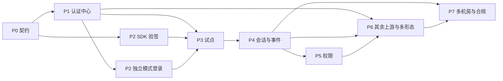

# 开发任务分解

本清单只拆 [`design.md`](design.md) §13 已经排进各阶段的工作，以及 [`spec/`](../spec/README.md)、[`conformance/`](../conformance/README.md) 里已经写明的验收条件。阶段日历以设计文档为准。表中的「人日」是单项工作量；同一阶段里可以并行，关键路径单独写在文末。未在 §14 决定的选型（Gin 或 Chi、PostgreSQL 或 MySQL、ES 或 ClickHouse、Vue3 或 React 等）任务里不代选。P1 上游适配已定为 OIDC，CAS 与 SAML 2.0 在 P6。

P0 的契约文件在仓库里已有草案。下面仍把它们列为 P0 任务，方便对照验收，不表示要推倒重写。

估期列的单位是人日。

## P0 契约（日历 1 周）

| ID | 标题 | 说明 | 依赖 | 人日 | 交付 / 验收 |
|---|---|---|---|---|---|
| P0-01 | 设计文档定稿 | 评审 [`design.md`](design.md)：目标、非目标、阶段、待定项 | — | 1 | §13：评审通过 |
| P0-02 | 机器可读契约 | 维护 OpenAPI、9 个 JSON Schema、`error-codes.yaml` | P0-01 | 2 | `run_reference.py` 中 schema 例子与 openapi 为 ok |
| P0-03 | 校验与权限规则 | 定稿 `token-validation.md`、`authorization.md` | P0-01 | 1 | 校验 12 步与权限匹配规则可单独实现 |
| P0-04 | 一致性向量 | 维护生成器、参考实现、`token-cases.json`（64）、`authz-cases.json`（30） | P0-02、P0-03 | 2 | 输出 `ALL PASSED` |

关键路径约 5 人日：P0-01 → P0-02 → P0-04。P0-03 与 P0-02 并行。

## P1 认证中心 MVP（日历 3 周）

验收：试点项目可以完成登录（§13）。

| ID | 标题 | 说明 | 依赖 | 人日 | 交付 / 验收 |
|---|---|---|---|---|---|
| P1-INF-01 | 会话 Redis 与配置库 | 按 §5.3.1 落 Redis 键。配置与用户落在 PostgreSQL 或 MySQL，二者不代选 | — | 3 | 全局会话、应用会话、refresh token 可按键读写。`auth:rt` 的 TTL 等于该客户端的 `refresh_token_ttl` |
| P1-AC-01 | Go 服务骨架 | Go 1.23+。HTTP 框架用 Gin 或 Chi，不代选 | — | 2 | 进程可启动，健康检查可用 |
| P1-AC-02 | 上游可插拔层与 OIDC 适配 | `IdentityProvider` 接口。P1 实现 OIDC 上游适配，使试点能登录。CAS 与 SAML 2.0 仍是必做范围，见 P6-AC-01、P6-AC-02 | P1-AC-01 | 6 | 用 OIDC 上游完成登录跳转与回调，得到 `Identity`（工号必填） |
| P1-AC-03 | 属性映射与用户落库 | 每个身份源一份 `attribute_mapping`。首次登录按工号建用户并给默认角色；空属性不覆盖已有值 | P1-AC-02 | 2 | 缺属性时登录仍成功 |
| P1-AC-04 | 授权码、PKCE 与刷新 | `authorize`（只接受 S256）、`token` 的 authorization_code 与 refresh_token。refresh 每次轮换，新 token 从轮换当时起重新计算 `refresh_token_ttl`。重放旧 token 吊销整条会话链并返回 `AUTH_REFRESH_REUSED` | P1-AC-01、P1-INF-01 | 5 | 试点浏览器能走完授权码。连续刷新时，每次得到的 refresh token 都重新计算有效期 |
| P1-AC-05 | Access Token 与 JWKS | `typ=at+jwt`，算法只允许 RS256 / ES256。有效期按 §5.2：客户端覆盖，否则用全局默认；用户 access token 默认 600 秒，且不超过 `access_token_ttl_cap`（默认 1800）。启动时拒绝与 `conformance/keys/` 相同的签名密钥 | P1-AC-04 | 3 | `/.well-known/openid-configuration` 与 `/oauth2/jwks` 可用。JWKS `Cache-Control: max-age=600` |
| P1-AC-06 | 全局会话的空闲与绝对时长 | 刷新时检查 `idle_timeout`、`absolute_session_ttl`，以及当前这张 refresh token 是否仍在 `refresh_token_ttl` 内（全局默认 600 秒，从签发或上次轮换起算）。先到期者拒绝刷新，返回 `AUTH_LOGIN_REQUIRED` | P1-INF-01、P1-AC-04 | 3 | 超过 600 秒没有轮换则不能再刷新。在 600 秒内持续轮换时，会话继续，直到空闲超时或绝对时长 |
| P1-AC-07 | 基础审计 | 登录成功、登录失败按 `audit-event.schema.json` 记录。`actor` 为对象。不记录 token、密码、ticket 原文。长期保存见 P7-AUD-01；ES 或 ClickHouse 不代选 | P1-AC-03 | 2 | 一次成功登录和一次失败登录能查出符合 schema 的事件 |
| P1-ADM-01 | 应用注册 | 管理后台注册应用，得到 `client_id` 与 `client_secret`，可配置回调地址、`client_type`、`session_policy`（`ClientLifetimes`）。前端 Vue3 或 React 不代选。OpenAPI 目前没有注册路径，实现时只使用设计已经写明的字段 | P1-AC-01、P1-INF-01 | 4 | 注册出的客户端能完成 P1 登录。未填的有效期等于 §5.2 全局默认 |
| P1-DOC-01 | 试点登录说明 | 写明 OIDC 上游怎么配、回调地址、滑动刷新和全局默认有效期 | P1-AC-02、P1-ADM-01 | 1 | 试点按文档能配通 |

关键路径约 15 人日：P1-AC-01 → P1-AC-02 → P1-AC-04 → P1-AC-05。P1-INF-01、P1-ADM-01、P1-AC-07 并行。

## P2 三端 SDK（日历 3 周，与 P1 后半段并行）

验收：三端全部通过一致性测试（§13）。验签可以先对 conformance 向量做，不阻塞在认证中心联调之后。

| ID | 标题 | 说明 | 依赖 | 人日 | 交付 / 验收 |
|---|---|---|---|---|---|
| P2-GO-01 | Go 验签与 User | 按 `token-validation.md` 的 12 步实现。时钟可注入。User 字段与 `user.schema.json` 一致，`client_id` 取自 `azp` | P0-04 | 4 | `token-cases.json` 64 例逐字段通过，含吊销匹配 |
| P2-PY-01 | Python 验签与 User | 与 Go 同一套规则。FastAPI Middleware / Depends | P0-04 | 4 | 同上 |
| P2-JV-01 | Java 验签与 User | SpringBoot starter，基于 Spring Security Resource Server | P0-04 | 4 | 同上 |
| P2-GO-02 | Go 独立模式登录 | `LoginHandler` 等：跳转、回调、登出 | P2-GO-01、P1-AC-04 | 3 | 独立模式能登录并拿到会话 |
| P2-PY-02 | Python 独立模式登录 | `ua.router` | P2-PY-01、P1-AC-04 | 3 | 同上 |
| P2-JV-02 | Java 独立模式登录 | 自动注册 `/auth/*` | P2-JV-01、P1-AC-04 | 3 | 同上 |
| P2-JS-01 | JS SDK | `login`、`logout`、`getUser`、带 401 处理的 `fetch`。纯前端走授权码 + PKCE。BFF 模式只保留 `getUser` 与 401 处理 | P1-AC-04 | 4 | 浏览器能登录；401 时按错误码 `client_action` 刷新或跳转登录 |
| P2-CI-01 | SDK 的一致性门禁 | 三端 CI 固定到 conformance 的 tag（文档示例为 `spec-v0.1.0`） | P2-GO-01、P2-PY-01、P2-JV-01 | 2 | CI 与 `run_reference.py` 的 token 用例结果一致 |
| P2-DOC-01 | `unified-auth doctor` | 检查连通性、JWKS、时钟偏差（§10.3） | P2-GO-01 | 2 | 对一个已注册客户端给出明确的通过或失败 |

关键路径约 15 人日：P0-04 → P2-GO-01 → P2-GO-02，与 P1 后半段重叠。Python、Java 与 Go 并行。权限校验不在本阶段，见 P5。

## P3 试点（日历 2 周）

验收：网关模式和独立模式各一个试点，生产灰度运行（§13）。不指定试点项目名称。

| ID | 标题 | 说明 | 依赖 | 人日 | 交付 / 验收 |
|---|---|---|---|---|---|
| P3-01 | 网关模式试点 | 网关先验签，转发原始 JWT，SDK 再验一次。禁止只信 `X-User-Id` 一类明文头 | P1-AC-05、P2-GO-01 | 5 | 灰度环境登录成功，业务请求不调用认证中心 |
| P3-02 | 独立模式试点 | SDK 内置登录、回调、登出 | P2-GO-02 或同级的 Py/Java 独立模式 | 5 | 灰度环境登录成功 |

两条试点并行，关键路径约 10 人日。

## P4 会话治理（日历 2 周）

验收：远程机房 Redis 可达时，下线操作 5 秒内全局生效（§13、R6）。

| ID | 标题 | 说明 | 依赖 | 人日 | 交付 / 验收 |
|---|---|---|---|---|---|
| P4-AC-01 | 多端登录策略 | 按用户 + 客户端类型计数。`allow`、`limit:N`、`kick_oldest`。达到上限返回 409 `AUTH_CONCURRENT_LIMIT` | P1-AC-06 | 3 | 三种策略各有一条可重复的检查 |
| P4-AC-02 | 强制下线接口 | `POST /users/{sub}/revoke`、`DELETE /sessions/{sid}`、`DELETE /app-sessions/{asid}`。`reason` 与吊销事件同为 9 种，缺省 `admin_kick`。事件 `type` 由接口决定 | P1-AC-06 | 3 | 三种 type 都能发出符合 `revocation-event.schema.json` 的事件 |
| P4-BUS-01 | EventBus 与 Redis Streams | 可替换接口。首期每个机房一条 `auth:events`（`auth.revoked` 与 `authz.changed`）。每个 SDK 实例自己的游标 `XREAD`，不共用 consumer group。流保留 `access_token_ttl_cap + clock_skew` | P1-INF-01 | 4 | 两个实例都收到同一条事件；断线后能从游标补上。游标被裁掉时走 `GET /api/v1/revocations?since=` |
| P4-BUS-02 | 写入每个机房的流 | 发布方把同一事件写入各机房 Redis。远程失败要重试 | P4-BUS-01 | 2 | 远程 Redis 可达时，5 秒内另一机房的订阅者收到事件。写失败时的空窗见 R6 |
| P4-AC-03 | 公网 SSE | `GET /api/v1/revocations/stream`：15 秒 ping，`Last-Event-ID`，超保留期再补拉。内网仍走事件通道 | P4-AC-02 | 3 | 断线重连不丢保留期内的事件 |
| P4-AC-04 | 单点登出 | 按全局会话给各应用发 OIDC back-channel logout。上游是否支持登出未确认（R1）；中心侧先闭环 | P4-AC-02 | 3 | 登出一个全局会话后，其应用会话都收到吊销 |
| P4-SDK-01 | 三端吊销同步 | `revocation.channel`：`auto` / `mq` / `sse` / `none`。`mq` 即 EventBus，首期 Redis Streams。本地保留时间不得小于 cap + `clock_skew`（默认 1860 秒） | P4-BUS-01、P2-GO-01、P2-PY-01、P2-JV-01 | 4 | 吊销类 token 用例在接上真实事件后结果不变 |

关键路径约 10 人日：P4-BUS-01 → P4-BUS-02，以及 P4-AC-02 → P4-SDK-01。

## P5 权限中心（日历 3 周）

验收：试点项目完成权限迁移（§13）。审批流不做（§1.2）。

| ID | 标题 | 说明 | 依赖 | 人日 | 交付 / 验收 |
|---|---|---|---|---|---|
| P5-AC-01 | 权限数据模型 | APP、PERMISSION、ROLE、USER_ROLE、APP_ADMIN。角色 scope 为 `global` 或 `app:<id>`。`grant_source` 含预留的 `approval`，不实现审批流 | P1-INF-01 | 4 | 能授予、收回角色，并递增 `perm_ver` |
| P5-AC-02 | 权限查询 API | `GET /api/v1/authz/users/{sub}/apps/{app}`。ETag 为 `perm_ver`，支持 304。返回未降级的 `data_scope` | P5-AC-01 | 3 | 与 `authz-result.schema.json` 一致 |
| P5-AC-03 | 权限清单同步 | `PUT /api/v1/apps/{app}/permissions`，含 `dry_run`。清单中消失的权限点标记 deprecated，不物理删除 | P5-AC-01 | 2 | 符合 `permissions-manifest.schema.json`。调用方 `client_id` 必须等于该应用 |
| P5-AC-04 | `authz.changed` | scope 为 user / role / app。走 P4 的事件通道 | P5-AC-01、P4-BUS-01 | 2 | 事件符合 `authz-changed-event.schema.json` |
| P5-SDK-01 | 权限判断与数据范围 | `has_perm`、`require_all` / `require_any`、数据范围合并与降级。所需权限里的通配符或空列表必须抛编程错误 | P0-04、P5-AC-02 | 5 | `authz-cases.json` 30 例通过 |
| P5-SDK-02 | 权限缓存 | 键 `(sub, app)`，TTL 取 min(本地 `cache_ttl` 默认 300 秒, 服务端 `cache_ttl`)。`perm_ver` 变大或收到 `authz.changed` 时刷新。中心不可用时使用过期缓存 | P5-SDK-01、P5-AC-04 | 3 | 中心关闭后，已缓存的授权仍可判定 |
| P5-ADM-01 | 角色与授权下放 | 全局角色只有平台管理员可管。应用角色由 `APP_ADMIN` 管理 | P5-AC-01 | 4 | 应用管理员不能改全局角色 |

关键路径约 15 人日：P5-AC-01 → P5-AC-02 → P5-SDK-01 → P5-SDK-02。

## P6 多形态与兼容（日历 3 周）

验收：三种上游适配都可用；各形态 demo 通过（§13）。下游兼容协议的先后见 D3，不代选。小程序先做微信（D4）。

| ID | 标题 | 说明 | 依赖 | 人日 | 交付 / 验收 |
|---|---|---|---|---|---|
| P6-AC-01 | 上游 CAS 适配 | P1 已做 OIDC。本任务实现 CAS 上游适配，与 P6-AC-02 并行，不规定二者先后 | P1-AC-02 | 5 | CAS 登录能归一成 `Identity` |
| P6-AC-02 | 上游 SAML 2.0 适配 | 实现 SAML 2.0 上游适配 | P1-AC-02 | 5 | CAS、SAML 2.0、OIDC 三种都能登录 |
| P6-AC-03 | 小程序绑定与 token exchange | 首次 web-view 走 SSO 绑定 openid；之后用 `wx.login` 的 code 交换 token。未绑定返回 `AUTH_BINDING_REQUIRED` 与一次性 `bind_ticket`。企业微信、钉钉不在本任务 | P1-AC-05 | 5 | 未绑定与已绑定各走通一次 |
| P6-AC-04 | client_credentials | m2m token：`sub` 为 `client:<id>`，无 `sid` / `asid` / refresh token。access token 默认 1800 秒，仍受 cap 限制。scope 不足返回 `SCOPE_INSUFFICIENT` | P1-AC-05 | 3 | 机器调用拿到的 User 中 `is_machine=true`，`emp_no=null` |
| P6-AC-05 | 用户 token exchange | `subject_token_type` 为 access token，`audience` 为目标应用 | P1-AC-05 | 2 | 换出的 token 里 `aud` 可以是数组，`azp` 为发起方 |
| P6-COMPAT-01 | 下游 SAML IdP | `/saml/metadata`、`/saml/sso`、`/saml/slo`。不在 OpenAPI 内。与 P6-COMPAT-02 谁先做见 D3 | P1-AC-06 | 5 | 一个测试 SP 能登录 |
| P6-COMPAT-02 | 下游 CAS Server | `/cas/login`、`/cas/serviceValidate`、`/cas/p3/serviceValidate`、`/cas/logout` | P1-AC-06 | 4 | 一个测试 CAS 客户端能校验 ticket |
| P6-JS-01 | JS SDK 的小程序交换 | 对接 P6-AC-03 | P6-AC-03、P2-JS-01 | 2 | 小程序 demo 能换到 token |
| P6-DEMO-01 | 形态 demo | App（系统浏览器 + PKCE）、小程序、Open API、以及已启用的下游兼容通道 | P6-AC-03、P6-AC-04、P6-COMPAT-01、P6-COMPAT-02 | 3 | §13：各形态 demo 通过 |

关键路径约 15 人日：P6-AC-03 → P6-JS-01，与 CAS / SAML 上游适配、下游兼容通道并行。

## P7 多机房与合规（日历 2 周）

验收：机房故障演练、等保自查（§13）。

| ID | 标题 | 说明 | 依赖 | 人日 | 交付 / 验收 |
|---|---|---|---|---|---|
| P7-INF-01 | 多机房会话 | `sid` 带机房前缀。刷新落到其他机房时转发回原机房，或用 GSLB 固定机房（R5）。机房故障时该机房会话失效，用户重新登录 | P1-AC-06、P4-BUS-02 | 4 | 演练：一台房停止后，另一机房的新登录仍可用；故障机房的旧会话不再刷新 |
| P7-BUS-01 | Kafka 版 EventBus | 同一接口的第二实现。每个 SDK 实例单独的 consumer group，从而仍然广播 | P4-BUS-01 | 4 | 切到 Kafka 后，P4 的双实例收齐事件仍然成立 |
| P7-BUS-02 | MirrorMaker 2 | 主题跨机房复制，替代「发布方写每个机房 Redis」 | P7-BUS-01 | 2 | 一个机房发布的事件出现在另一个机房的主题上 |
| P7-AC-01 | 签名密钥轮换 | 每 90 天轮换。轮换前 JWKS 同时有当前密钥和下一把；轮换后上一把再保留 `access_token_ttl_cap + previous_key_buffer`（默认 1860 秒） | P1-AC-05 | 3 | 轮换窗口内，旧 `kid` 与新 `kid` 都能验过 |
| P7-AUD-01 | 审计长期存储 | 只追加、不可改。保存不少于 6 个月。查询权限仅审计员，查询本身写 `audit.query`。ES 或 ClickHouse 不代选 | P1-AC-07 | 3 | 超出保存期之前的记录仍可查；一次查询产生审计 |
| P7-ADM-01 | 管理后台二次认证 | 上游没有 MFA 时叠加 TOTP（R1）。上游若已有 MFA，不重复发明第二套 | P1-ADM-01 | 2 | 未完成二次认证不能打开管理后台 |

关键路径约 10 人日：P7-BUS-01 → P7-BUS-02，与 P7-INF-01 并行。

## 持续

| ID | 标题 | 说明 | 依赖 | 人日 | 交付 / 验收 |
|---|---|---|---|---|---|
| C-01 | 存量项目迁移 | 逐个迁移。迁移时可以要求用户重新登录 | P3-01 或 P3-02 | — | 该项目不再直接对接上游 SSO |
| C-02 | SDK 版本治理 | 业务仓的 CI 固定 conformance / spec 的 tag | P2-CI-01 | — | 升级 tag 之前，行为以该 tag 的向量为准 |

## 依赖与关键路径

按 §13 的日历相加，P0 到 P7 为 1+3+2+2+3+3+2 = 16 周。P2 的验签与 P1 后半段并行，不另外加上整整 3 周。P2 的独立模式登录要等 P1 的授权码端点。CAS 与 SAML 上游适配只依赖 P1 的接口，但阶段表把它们放在 P6，本清单不把它们提前。

先到达「试点能登录」的路径是 P0 → P1 → P3，其中 P2 的验签要在网关试点之前完成。

## 仍未决定的事项

实现时不要在这些条目里自行挑一个当作已经定稿：

| 编号 | 事项 | 出处 |
|---|---|---|
| — | HTTP 框架 Gin 或 Chi | §4.2 |
| — | PostgreSQL 或 MySQL | §4.2 |
| — | 审计落 ES 或 ClickHouse | §4.2 |
| — | 管理后台 Vue3 或 React | §4.2 |
| D3 | 下游 SAML 与 CAS 谁先做 | §14 |
| D4 | 企业微信、钉钉是否做。微信已定为首个小程序平台 | §14 |
| R1 | 上游是否支持单点登出和 MFA | §14 |
| R2 | 上游实际返回哪些属性 | §14 |
| R5 | 跨机房刷新用转发还是 GSLB。文档允许先用 GSLB | §7.1、§14 |
